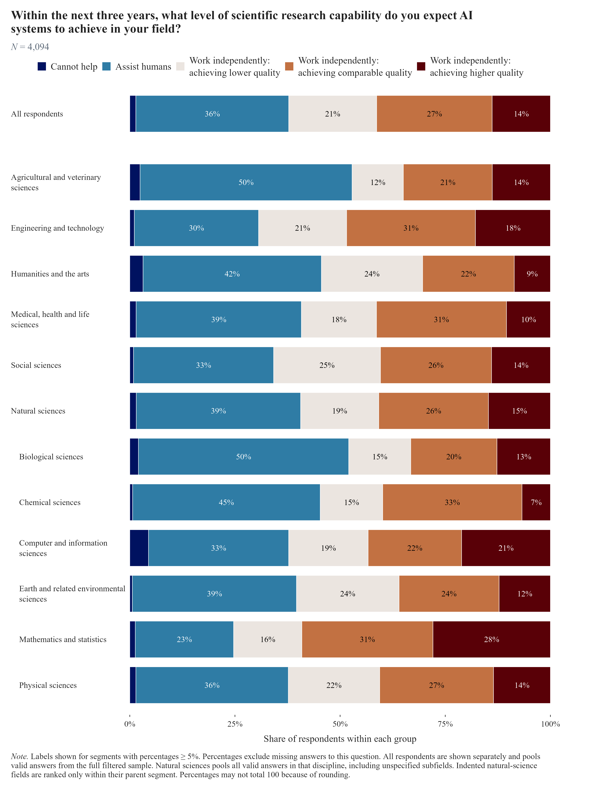
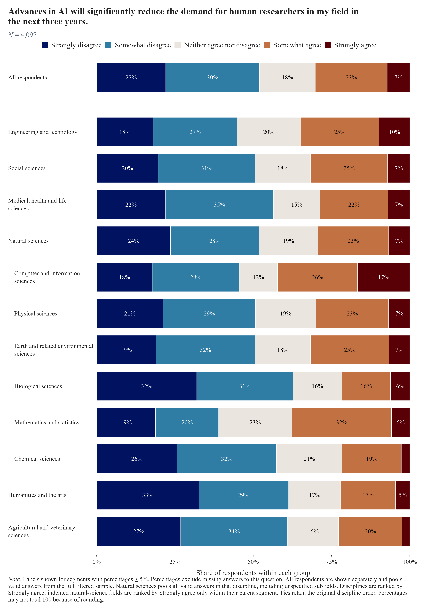
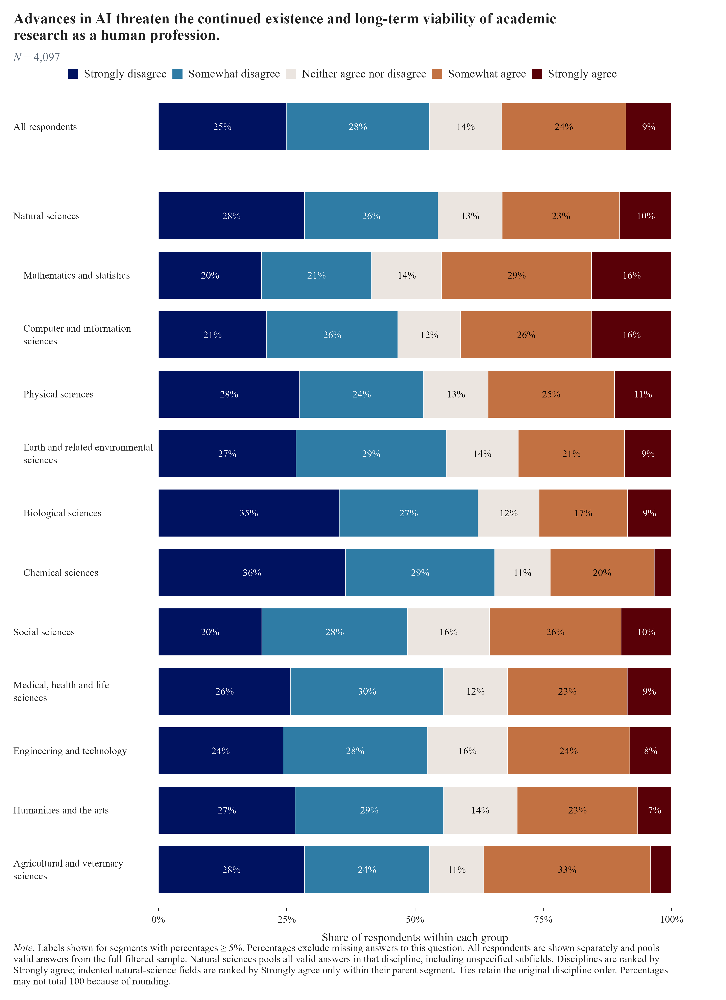
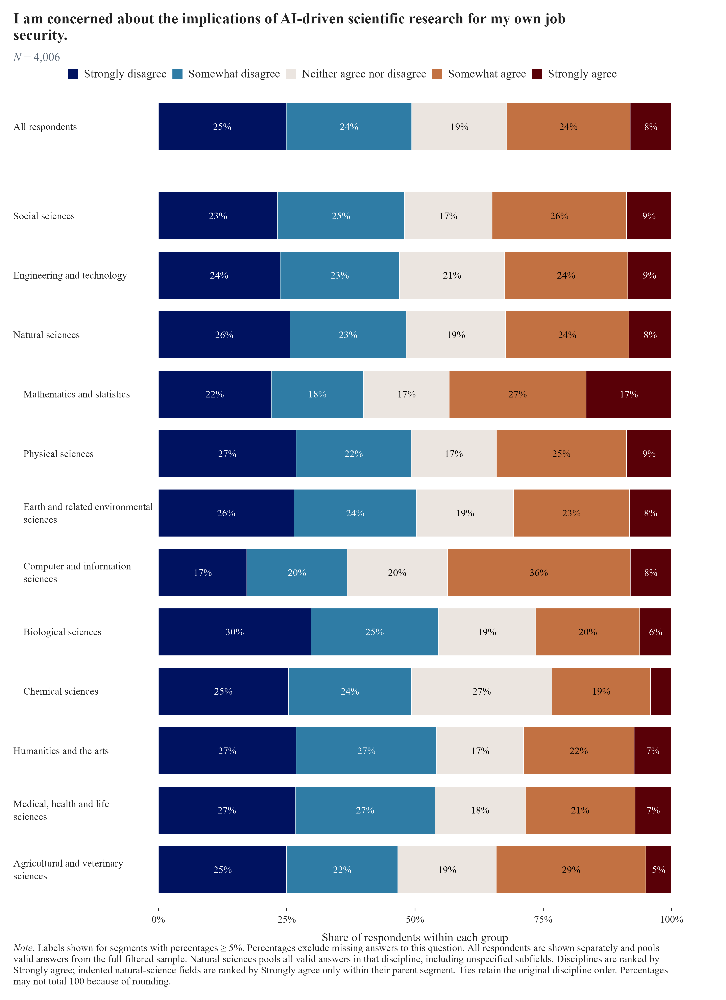
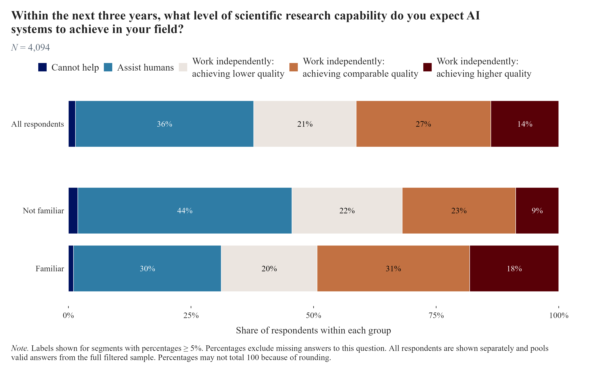
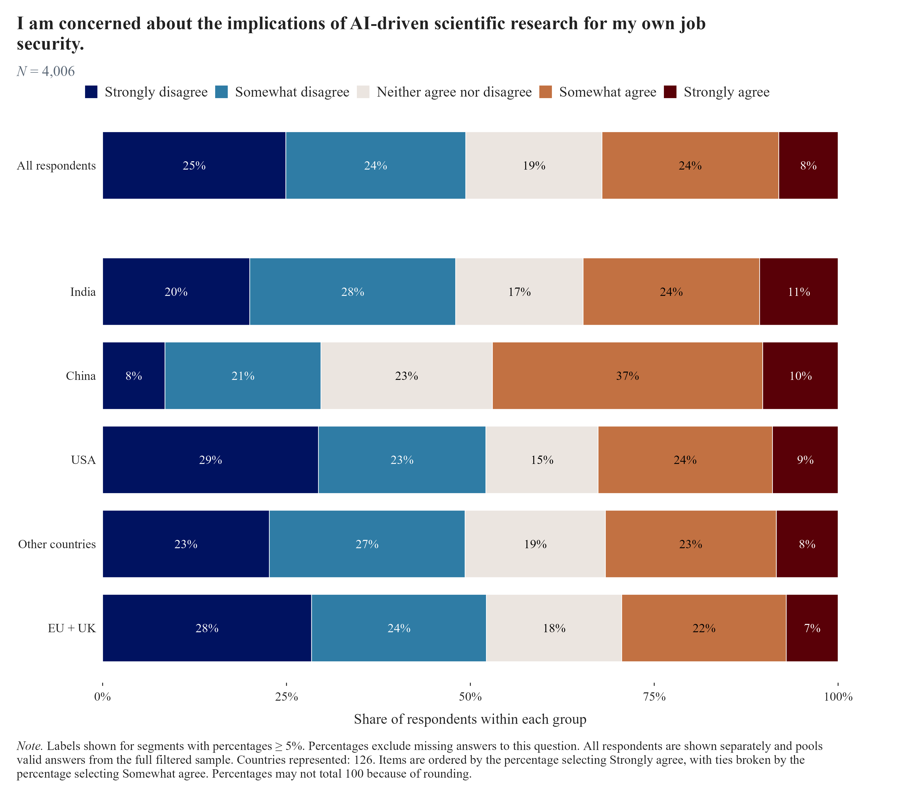
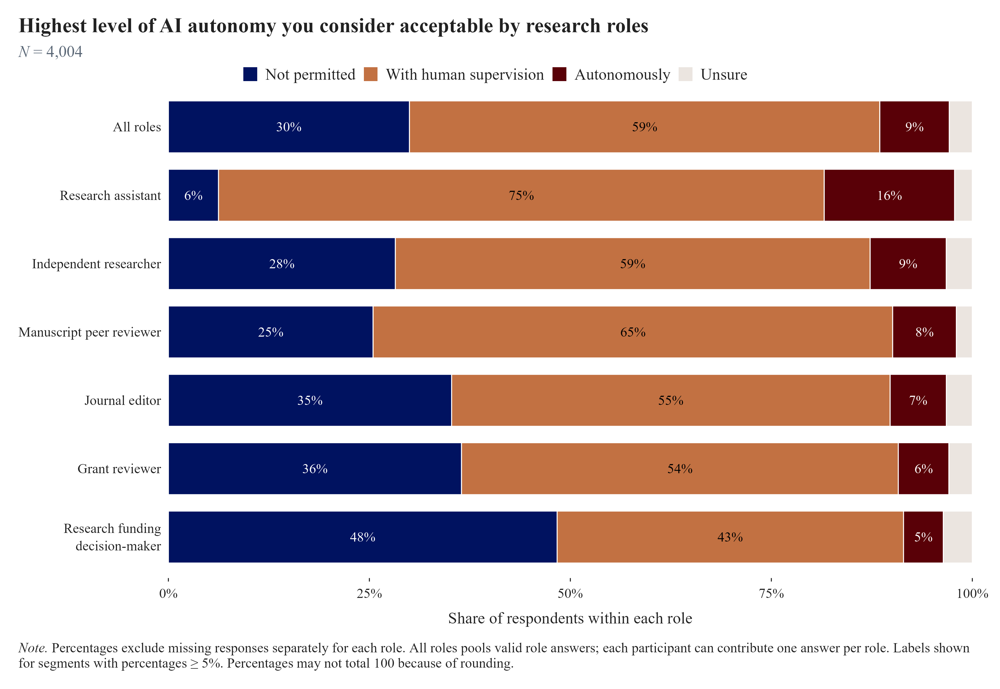
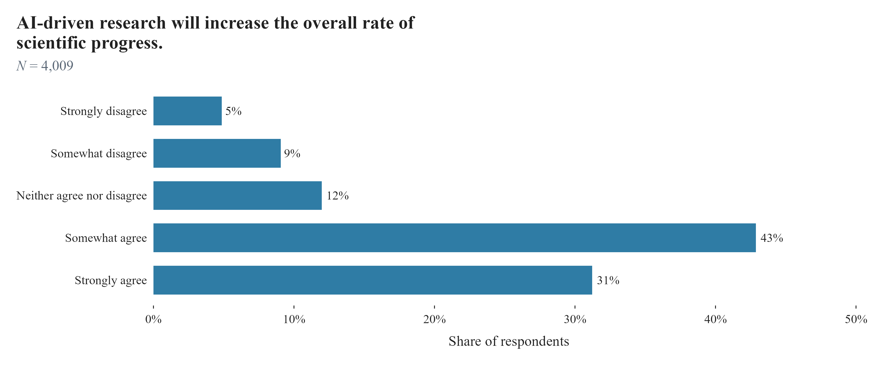

```{r setup, include=FALSE}

library(tidyverse)

getwd()

data =  read.csv("../survey_11_17.csv")

data = data[3:nrow(data), ]

data_filtered = data |> 
  filter(consent == "Yes",
         data_quality == "Yes",
         'Duration (in seconds)' >= 60,
         Progress == 100)

n_counties = data_filtered |> 
  group_by(country) |> 
  summarise(n = n()) |> 
  arrange(desc(n))

n_countries = nrow(n_counties)
```

```{=html}
<style>
@page { size: A4 portrait; margin: 0; }
body { background: #f2f2f2; }
.main-container {
  width: 210mm;
  max-width: none;
  min-height: 297mm;
  box-sizing: border-box;
  margin: 12mm auto;
  padding: 5mm;
  background: white;
}
@media print {
  html, body {
    width: 210mm !important;
    margin: 0 !important;
    padding: 0 !important;
    background: white;
  }
  .main-container {
    width: 210mm !important;
    max-width: none !important;
    min-height: 0;
    margin: 0 !important;
    padding: 5mm !important;
  }
  .figure { break-inside: avoid; }
  .figure img { width: 100%; max-width: 100%; }
  h2, h3 { break-after: avoid; }
}

h2, h3 {
  font-family: "Times New Roman", Times, serif;
  font-weight: 700;
  line-height: 1.25;
}
h2 { font-size: 30px; margin-top: 48px; margin-bottom: 28px; }
h3 { font-size: 25px; margin-top: 56px; margin-bottom: 24px; }
.figure {
  display: flex;
  flex-direction: column;
  margin-bottom: 28px;
}
.figure .caption {
  order: -1;
  text-align: right;
  font-family: "Times New Roman", Times, serif;
  font-size: 16px;
  font-weight: 400;
  font-style: italic;
  margin: 0 0 6px;
}
h1.title {
  font-family: "Times New Roman", Times, serif;
  font-size: 30px;
  font-weight: 700;
}

h4.author {
  font-family: "Times New Roman", Times, serif;
  font-size: 18px;
  font-weight: 400;
}

.contact-info {
  font-family: "Times New Roman", Times, serif;
  font-size: 12px;
  font-weight: 400;
  color: #555;
  line-height: 1.4;
  margin: 4px 0 20px;
}
.contact-info a { color: inherit; }

</style>
```

<h2 style="text-align: center;">

Selection of survey results

</h2>

### Disciplinary variation

```{r, echo=FALSE, out.width="100%", fig.align="center", fig.cap="1"}

```

```{r, echo=FALSE, out.width="100%", fig.align="center", fig.cap="2"}

```

```{r, echo=FALSE, out.width="100%", fig.align="center", fig.cap="3"}

```

```{r, echo=FALSE, out.width="100%", fig.align="center", fig.cap="4"}

```

### Differences in opinions by familiarity with OpenAI’s mathematics articles

```{r, echo=FALSE, out.width="100%", fig.align="center", fig.cap="5"}

```

### Geographical variation

```{r, echo=FALSE, out.width="100%", fig.align="center", fig.cap="6"}

```

### Overall trend

```{r, echo=FALSE, out.width="100%", fig.align="center", fig.cap="7"}

```

```{r, echo=FALSE, out.width="100%", fig.align="center", fig.cap="8"}

```

<p class="contact-info">The author order does not reflect the final contributorship. For more information, please contact Balazs Aczel at <a href="mailto:aczel.balazs@ppk.elte.hu">aczel.balazs@ppk.elte.hu</a>.</p>